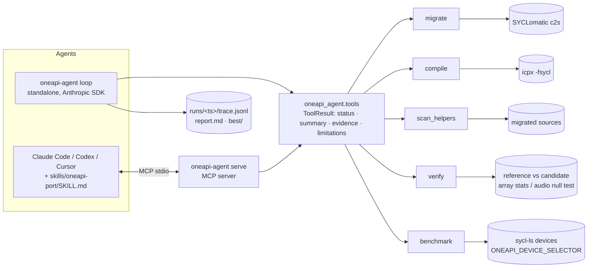

# oneapi-agent-toolkit

**Evidence-driven MCP toolkit that makes coding agents fluent in oneAPI/SYCL.**

SYCLomatic translates most of a CUDA code base to SYCL. What is left is the last mile:
- code it could not migrate,
- output full of `dpct::` helpers,
- no proof that the port behaves like the original,
- agents that keep writing CUDA-flavoured code.

This toolkit gives an agent (Claude Code, Codex, Cursor, or the bundled standalone loop) five tools for that last mile: **migrate, compile, scan_helpers, verify, benchmark**. It also ships a skill that tells the agent how to use them.

Every tool returns **structured evidence, never a bare claim**: a status, the exact commands that ran, parsed diagnostics, numbers, and an explicit list of limitations.
"It works" means `verify` returned `ok` on the current code. "It's portable" means `scan_helpers` found zero helpers. Nothing is reported that was not measured.

## The last-mile problem, observed

These results come from running this repo's pipeline (`examples/run_pipeline.py`) on its own examples.
Full output is in [`examples/RESULTS.md`](examples/RESULTS.md). Toolchain: icpx 2026.1.1, c2s/SYCLomatic 21.0.0 (dpct version string), OpenCL CPU device.

| Example | c2s warnings | raw migration compiles | raw migration verifies | dpct helpers left | hand-written idiomatic port |
|---|---|---|---|---|---|
| fuzz (audio) | 4 | ✅ | ✅ -138.5 dBFS residual | 22 | ✅ verify, 0 helpers |
| FIR 64-tap (audio) | 4 | ✅ | ✅ -135.0 dBFS residual | 14 | ✅ verify, 0 helpers |
| saxpy | 1 | ✅ | ✅ max err 4.8e-7 | 11 | ✅ verify, 0 helpers |
| HeCBench softmax | **0** | ✅ | ❌ **22,156 / 524,288 elements wrong** | 9 | ✅ verify, 0 helpers |

For softmax, c2s produced code that compiles cleanly with **zero migration warnings**, but it translated `expf` to the reduced-precision `sycl::native::exp`, giving up to 3,473 ULP of error.
Only behavioural verification caught it. Swapping in `sycl::exp` brings it back to 9.3e-8.
`scan_helpers` now flags `sycl::native::` math as an advisory. That is the evidence-first loop in practice.

## Architecture



| Tool | Does | Key evidence |
|---|---|---|
| `migrate(cuda_path, out_dir)` | runs c2s | migrated files; DPCT warnings as `{code, id, message, file, line, migrated_file, migrated_line}` (from both stderr and inline comments); parse errors, which c2s can hit while still exiting 0 |
| `compile(sources, flags)` | `icpx -fsycl` | diagnostics `{file, line, column, severity, message, flag, snippet}`, linker errors, counts |
| `scan_helpers(path)` | inventories `dpct::`, `DPCT_*`, `<dpct/…>` (comments ignored) | totals by category, symbol and file; per-category SYCL 2020 replacement advice; advisories (sub-group 32, 3-D-for-1-D launches, `native::` math) |
| `verify(reference_cmd, candidate_cmd, inputs, tolerance)` | runs both, compares | array mode: max abs, RMS, rel error, float32 ULP, first mismatches. Audio mode: residual peak and RMS in dBFS per channel, null depth; passes at ≤ -96 dBFS by default |
| `benchmark(cmd, runs, devices)` | N timed runs per SYCL device | min, median, p95, max, stdev and raw samples per device; optional program-reported kernel times |

Statuses are `ok | fail | error | toolchain_missing | timeout`.
A missing binary is never faked: the result is `toolchain_missing`, with the exact command that could not run.

## Quickstart

```bash
pip install -e ".[all]"                  # Python 3.11+
oneapi-agent --summary doctor            # what toolchain was found

# Optional, real toolchain (see docs/install.md); this is the route verified here:
scripts/install-toolchain.sh /opt && source scripts/oneapi-env.sh

# Use the tools directly
oneapi-agent migrate examples/saxpy/saxpy.cu -o /tmp/saxpy_mig
oneapi-agent compile /tmp/saxpy_mig/saxpy.dp.cpp -o /tmp/saxpy_sycl
oneapi-agent scan-helpers /tmp/saxpy_mig
g++ -O2 examples/saxpy/saxpy_ref.cpp -o /tmp/saxpy_ref
oneapi-agent verify --ref "/tmp/saxpy_ref {output}" --cand "/tmp/saxpy_sycl {output}" --atol 1e-6
oneapi-agent benchmark "/tmp/saxpy_sycl /tmp/out.bin" --runs 5

# Serve them to an agent over MCP (registration for Claude Code / Codex / Cursor: docs/install.md)
oneapi-agent serve

# Standalone agent loop
oneapi-agent loop --dry-run --mock-tools                 # no toolchain, no API key
oneapi-agent loop --dry-run --config examples/saxpy/task.json   # scripted model, real tools
ONEAPI_AGENT_API_KEY=... oneapi-agent loop --config examples/fir/task.json   # real model
```

The loop's model comes from `ONEAPI_AGENT_MODEL` (default `claude-sonnet-5-5`).
- The API key comes from `ONEAPI_AGENT_API_KEY` if set, otherwise `ANTHROPIC_API_KEY`. Use `ONEAPI_AGENT_API_KEY` inside Claude Code sessions, which blank `ANTHROPIC_API_KEY`; with it the loop always talks to `https://api.anthropic.com` (override with `ONEAPI_AGENT_BASE_URL`), never an inherited `ANTHROPIC_BASE_URL`.
- Optional: `ONEAPI_AGENT_EFFORT` sets the effort level.
- `ONEAPI_AGENT_FALLBACKS=0` disables the server-side refusal fallback, which is on by default.

The loop declares success only when compile, verify and a zero-helper scan all hold for **the same current source tree**. The model cannot pick verify's commands or tolerances.

## Example run output

This is real output from `oneapi-agent loop --dry-run --config examples/saxpy/task.json`.
The model is **scripted**, so no LLM was involved, but every tool result comes from a real tool run. Full files: [`docs/example-run/report.md`](docs/example-run/report.md) and [`trace.jsonl`](docs/example-run/trace.jsonl).

```
| it | tool         | status | summary |
|----|--------------|--------|---------|
| 1  | migrate      | ok     | migrated 1 CUDA file(s) -> 1 file(s); 1 DPCT warning(s) (DPCT1009x1) |
| 3  | compile      | ok     | compiled 1 source(s) -> …/work/build/candidate (0 warning(s)) |
| 4  | scan_helpers | fail   | 11 dpct helper use(s) remain in 1 file(s) (events_timing=3, macro=2, device_queue_management=2, memory_management=2) |
| 5  | write_file   | ok     | wrote migrated/saxpy.dp.cpp (1386 chars) |
| 5  | compile      | fail   | compile failed with 15 error(s) at …/saxpy.dp.cpp:15: use of undeclared identifier 'sycl' |
| 6  | write_file   | ok     | wrote migrated/saxpy.dp.cpp (1411 chars) |
| 6  | compile      | ok     | compiled 1 source(s) -> …/work/build/candidate (0 warning(s)) |
| 6  | scan_helpers | ok     | no dpct helpers in 1 file(s) |
| 7  | verify       | ok     | PASS: 1/1 case(s) match (worst max abs err 4.77e-07, atol 1e-06) |
| 7  | benchmark    | ok     | 5 run(s) each; Intel(R) Xeon(R) Processor @ 2.80GHz: median 217.41 ms, p95 239.39 ms |

What failed and what fixed it
- it 5: `compile:saxpy.dp.cpp:15:use of undeclared identifier 'sycl'` → fixed by iteration 6 after editing saxpy.dp.cpp
```

Benchmark numbers are whole-process wall time on a 4-vCPU cloud VM's OpenCL **CPU** device. They include SYCL start-up and JIT compilation. See [`examples/README.md`](examples/README.md#benchmark-caveats-read-before-quoting-numbers) before quoting them.

## Status

| Component | Status | Notes |
|---|---|---|
| `migrate` (c2s) | ✅ working | verified with SYCLomatic 21.0.0 (release 20260701) + CUDA 12.3 headers |
| `compile` (icpx) | ✅ working | verified with icpx 2026.1.1 (conda-forge) |
| `scan_helpers` | ✅ working | static text scan; 11 categories plus advisories |
| `verify` array / audio | ✅ working | real subprocesses; 32-bit float WAV recommended for the -96 dBFS test |
| `benchmark` | ✅ working | verified on the OpenCL CPU device only; **no GPU tested** |
| MCP server | ✅ working | in-process `list_tools` / `call_tool` tested (mcp 2.3.0; mcp 1.x import path supported) |
| Registration in Claude Code / Codex / Cursor | 🟡 documented, not exercised | configs follow each client's documented format; no client available in the build sandbox |
| Skill `oneapi-port` | ✅ written | the procedure, loop rules and report template |
| Standalone loop, dry run (scripted model) | ✅ working | mocked and real-tool runs; success, stuck, max-iterations and budget paths are tested |
| Standalone loop with a real model | 🟡 implemented, **not run** | no `ANTHROPIC_API_KEY` in the build sandbox |
| CUDA examples executed on NVIDIA hardware | ⬜ not done | no NVIDIA GPU; the plain C++ references are the ground truth |
| Tests | ✅ 78 tests | pass with and without the toolchain (toolchain tests auto-skip) |

## Roadmap

- Run the real-model loop on all four examples and publish the traces, including how many iterations each takes.
- GPU validation: Intel Arc/Max through Level Zero, and NVIDIA through the CUDA plugin, so the reference can be the actual CUDA binary.
- AOT builds (`-fsycl-targets=`) and in-process kernel timing by default, so benchmarks exclude JIT.
- `verify` input generators (random arrays, edge cases such as denormals, NaN and huge values) and multi-output programs.
- More scan rules: `sycl::ext::oneapi::experimental` usage, implicit `double` on devices without fp64, USM `malloc_shared` in hot loops.
- Multi-file CUDA projects using `compile_commands.json` (`c2s -p`).

## Credits

- **[REA](https://github.com/morluto/rea)** (MIT) inspired the design. Its evidence-first approach, where tools return structured evidence rather than claims, is the principle this toolkit is built on.
- **[SYCLomatic](https://github.com/oneapi-src/SYCLomatic)** (Intel; Apache-2.0 with LLVM exceptions) does the bulk CUDA→SYCL migration that this toolkit drives and post-processes.
- **[HeCBench](https://github.com/zjin-lcf/HeCBench)** (Zheming Jin et al.; BSD-3-Clause) is the source of the softmax example. See `examples/softmax_hecbench/LICENSE.HeCBench`.
- Intel oneAPI DPC++/C++ Compiler (`icpx`).

## License

MIT; see [LICENSE](LICENSE). Third-party example code keeps its original license, as noted above.

---
Project tracking: [PROGRESS.md](PROGRESS.md) (what was done, what is blocked) · [DECISIONS.md](DECISIONS.md) (choices made autonomously) · [docs/install.md](docs/install.md)
