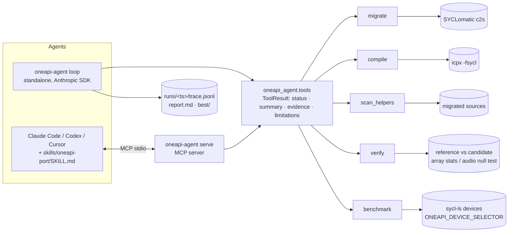

# oneapi-agent-toolkit

**Evidence-driven MCP toolkit that makes coding agents fluent in oneAPI/SYCL.**

SYCLomatic migrates most of a CUDA code base to SYCL. What remains is the last mile: code it could not translate, output full of `dpct::` helpers, and no proof the port still behaves like the original. Coding agents can do this work, but left alone they drift back to CUDA idioms and report success without checking.

oneapi-agent-toolkit is an open-source MCP server and agent skill that gives Claude Code, Codex, Cursor and other MCP-capable agents (or the bundled standalone loop) five tools: **migrate** (SYCLomatic), **compile** (icpx), **scan_helpers**, **verify** and **benchmark**. Inspired by the evidence-first design of the [REA](https://github.com/morluto/rea) project, every tool returns structured evidence and its limitations, never a bare claim. A port counts as done only when behavioural verification passes and no dpct helpers remain, both on the same source.

**[We ran 120 ports](#does-the-toolkit-actually-help)** of four workloads (an audio waveshaper, a 64-tap FIR filter, SAXPY and HeCBench softmax) on two Claude models, and graded every final port with a hidden test. With the toolkit, **40 of 40** ports were correct and helper-free. Without its checks, **23 of 40** were, and one unchecked softmax port compiled cleanly yet got 332,679 of 524,288 outputs wrong. Giving the agent a shell to test its own code removed wrong output but not unfinished migration: only **14 of 40** ports were helper-free. [SYCLomatic shows the same failure mode](#the-last-mile-problem-observed): its softmax output compiled with zero warnings while `expf` had silently become a reduced-precision builtin.

**[Then we closed the loop from CUDA to GPU](docs/agent-ports/README.md) with no human edits.** On five HeCBench programs the agent had never seen, it produced **15 of 15** correct, helper-free ports with the toolkit and **6 of 15** without. A [one-command GPU test](#checked-on-nvidia-and-amd-gpus), which rents a machine, runs the checks and always deletes it, then ran the agent's unedited ports on NVIDIA GPUs and an AMD Instinct MI350X: **all 10** matched both the C++ reference and the original CUDA built for that GPU.

Each result above links to the committed output behind it: traces, final sources and tool results for every run. A tool result carries a status, the exact commands that ran, parsed diagnostics, numbers, and an explicit list of limitations.
"It works" means `verify` returned `ok` on the current code. "It's portable" means `scan_helpers` found zero helpers. Nothing is reported that was not measured.

### Check it yourself

| Claim | Evidence |
|---|---|
| 120 ports, two models: toolkit 40/40, no checks 23/40, shell only 14/40 | [`docs/ablation/round2/`](docs/ablation/round2/README.md): the table, plus every run's trace, report and final source |
| An unchecked softmax port compiled cleanly and got 332,679 of 524,288 outputs wrong | [that run's trace, report and final source](docs/ablation/round2/runs/claude-sonnet-5-5/baseline/softmax_hecbench/run3/); a step-through replay is in [`docs/replay/`](docs/replay/) (download and open the `.html`) |
| SYCLomatic silently turned `expf` into the reduced-precision `sycl::native::exp` (22,156 of 524,288 wrong on an AVX-512 CPU; within tolerance on AVX2) | [`examples/RESULTS.md`](examples/RESULTS.md) |
| Five unseen programs end to end: toolkit 15/15, without 6/15; the agent's ports PASS 10/10 on NVIDIA and an AMD MI350X | [`docs/agent-ports/`](docs/agent-ports/README.md): 45 agent runs, the agent's exact sources, every GPU tool result |
| One command rents a GPU on four clouds, verifies against the original CUDA, and deletes the machine | [`docs/gpu-testing.md`](docs/gpu-testing.md), results in [`docs/gpu-run/`](docs/gpu-run/) |
| A real model ports the four original examples | [`docs/real-runs/`](docs/real-runs/) |
| cuBLAS → oneMath, run and verified | [`examples/gemm_cublas/`](examples/gemm_cublas/) |
| CI re-checks the claims with the real toolchain on every push | [`scripts/check_claims.py`](scripts/check_claims.py), [CI runs](https://github.com/checocadena/oneapi-agent-toolkit/actions/workflows/ci.yml) |

To re-run it: the [Quickstart](#quickstart) installs the toolchain; `scripts/ablation.py` repeats the with/without comparison with your own model key, and `oneapi-agent remote-test <task.json> --provider runpod` repeats a GPU check with your own GPU-cloud key.

## The last-mile problem, observed

These results come from running this repo's pipeline (`examples/run_pipeline.py`) on its own examples.
Full output is in [`examples/RESULTS.md`](examples/RESULTS.md). Toolchain: icpx 2026.1.1, c2s/SYCLomatic 21.0.0 (dpct version string), OpenCL CPU device.

| Example | c2s warnings | raw migration compiles | raw migration verifies | dpct helpers left | hand-written idiomatic port |
|---|---|---|---|---|---|
| fuzz (audio) | 4 | ✅ | ✅ -138.5 dBFS residual | 22 | ✅ verify, 0 helpers |
| FIR 64-tap (audio) | 4 | ✅ | ✅ -135.0 dBFS residual | 14 | ✅ verify, 0 helpers |
| saxpy | 1 | ✅ | ✅ max err 4.8e-7 | 11 | ✅ verify, 0 helpers |
| HeCBench softmax | **0** | ✅ | ❌ **22,156 / 524,288 elements wrong** (AVX-512 CPU; see below) | 9 | ✅ verify, 0 helpers |
| cuBLAS SGEMM → oneMath | 3 | ✅ (links oneMKL) | ✅ max err 5.7e-6 | 37 | ✅ verify, 0 helpers, oneMath API |

For cuBLAS, c2s 21.0.0 emits the oneMKL product API (`oneapi::mkl::blas`), not the UXL Foundation's open oneMath; `scan_helpers` flags that as an `onemkl_product_api` advisory, and the idiomatic port uses `oneapi::math::blas`.

For softmax, c2s produced code that compiles cleanly with **zero migration warnings**, but it translated `expf` to the reduced-precision `sycl::native::exp`, giving up to 3,473 ULP of error.
Only behavioural verification caught it. Swapping in `sycl::exp` brings it back to 9.3e-8.
Whether the wrong results exceed the tolerance depends on the CPU's instruction set: they fail on our AVX-512 Xeon (22,156 wrong, up to 4.1e-6) but stay just inside 1e-6 (6.9e-7) on AVX2 machines such as GitHub's CI runners.
The silent `expf` → `native::exp` substitution happens everywhere, and CI asserts it on every push.
`scan_helpers` now flags `sycl::native::` math as an advisory. That is the evidence-first loop in practice.

## A real model closing the gap

`oneapi-agent loop` with `claude-sonnet-5-5` driving the real tools (c2s 21.0.0, icpx 2026.1.1, OpenCL CPU device).
The loop declares success only when compile, verify and a zero-helper scan all hold on the same source tree.
Traces and reports: [`docs/real-runs/`](docs/real-runs/).

| Example | Stop reason | Iterations (max 8) | Estimated cost |
|---|---|---|---|
| saxpy | `success` | 8 | $0.082 |
| fuzz (audio) | `success` | 5 | $0.075 |
| FIR 64-tap (audio) | `success` | 6 | $0.067 |
| HeCBench softmax | `success` | 6 | $0.079 |

All four end with 0 dpct helpers and a passing `verify`. That is one run per example, so treat iteration counts as anecdotes, not a distribution.

## Checked on NVIDIA and AMD GPUs

`oneapi-agent remote-test` rents a GPU (Runpod, Vast.ai, Vultr or DigitalOcean), builds the C++ reference and the original CUDA there (`nvcc`, or `hipify-perl` + `hipcc` on AMD), verifies the SYCL port against both, benchmarks it, and **always deletes the machine and confirms it is gone**. Spending is capped per run. How it works and what broke on real clouds: [`docs/gpu-testing.md`](docs/gpu-testing.md).

**The agent's own ports, unedited** ([`docs/agent-ports/`](docs/agent-ports/README.md)). Max abs error vs the C++ reference / vs the original CUDA on the same GPU:

| Program | NVIDIA | AMD Instinct MI350X |
|---|---|---|
| stencil1d | 0 / 0 (L4) | 0 / 0 |
| matrix_rotate | 0 / 0 (RTX A4500) | 0 / 0 |
| atomic_reduction | 0 / 0 (RTX 2000 Ada) | 0 / 0 |
| scan | 0 / 0 (L4) | 0 / 0 |
| adam | 2.38e-7 / 5.96e-8 (RTX 4000 Ada) | 2.38e-7 / 5.96e-8 |

**The hand-written reference ports** ([`docs/gpu-testing.md`](docs/gpu-testing.md)): softmax passes on an RTX 2000 Ada (Runpod), an A16 (Vultr), an RTX A4000 (Vast.ai) and an AMD MI350X (DigitalOcean), and all six HeCBench programs pass on the MI350X. Making the softmax port use an in-order queue, as CUDA's default stream is, cut its per-launch cost on the MI350X from 114.6 to 24.4 us (the original CUDA, hipified: 8.9 us).

The first manual run, on an NVIDIA RTX 2000 Ada with [`scripts/gpu-run.sh`](scripts/gpu-run.sh) ([`docs/gpu-run/rtx2000ada/`](docs/gpu-run/rtx2000ada/SUMMARY.md)), checked the four original examples:

| Example | CUDA vs C++ reference | SYCL-on-GPU vs C++ reference | SYCL-on-GPU vs CUDA binary |
|---|---|---|---|
| fuzz | ✅ -138.5 dBFS | ✅ -138.5 dBFS | ✅ bit-exact |
| FIR | ✅ -135.0 dBFS | ✅ -135.0 dBFS | ✅ bit-exact |
| saxpy | ✅ | ✅ | ✅ max abs err 0 |
| softmax | ✅ | ✅ | ✅ max abs err 7.45e-9 |

Kernel timings come from single small launches and are not a performance claim. Intel GPUs have not been run yet: Intel's cloud has no public API, so that path is a [bundle](docs/gpu-testing.md#a-gpu-this-machine-cannot-reach-bundles) run by hand.

## Does the toolkit actually help?

Same tasks, same prompts. Five runs per example (20 per cell), on two models, in three arms:
- **toolkit:** the normal loop.
- **baseline:** no `scan_helpers`, `verify` or `benchmark`; the run ends when the agent says it is done.
- **baseline + shell:** the baseline plus a bash shell, so the agent can build and run its own tests.

A hidden check the agent never sees graded every final port the same way: compile, `verify` against the reference, count dpct helpers.
Details and all 120 runs: [`docs/ablation/round2/`](docs/ablation/round2/README.md). The first, smaller round is in [`docs/ablation/`](docs/ablation/README.md).

| Model | toolkit | baseline | baseline + shell |
|---|---|---|---|
| claude-sonnet-5-5 | **20/20** | 10/20 | 7/20 |
| claude-haiku-5-5 | **20/20** | 13/20 | 7/20 |

*Cells: ports that are correct **and** have 0 dpct helpers.*

- **Wrong output:** without any checks, agents shipped wrong output in 6 of 40 runs, including a softmax port that compiled cleanly but got 332,679 of 524,288 outputs wrong. With a shell, none did. Testing catches bugs.
- **Unfinished conversion:** with a shell, agents still left SYCLomatic's dpct helpers in 26 of 40 runs, though the prompt asked for zero. They stopped once the code worked. The helper scan is what finishes the port.
- **Cost:** the toolkit arm costs about the same as the baseline: $1.37 vs $1.23 for 20 Sonnet runs.

5 runs per cell, two models from one vendor, CPU device only: indicative, not a benchmark.

### Five more programs, the agent's ports run on GPUs

The same comparison on five HeCBench programs the agent had never seen (stencil1d, matrix_rotate, atomic_reduction, scan, adam), claude-sonnet-5-5, 3 runs per arm: toolkit **15/15**, baseline 6/15, baseline + shell 6/15. No arm produced wrong output here; every miss was dpct helpers left in while the agent reported success. The toolkit's ports then passed unedited on NVIDIA and AMD GPUs ([above](#checked-on-nvidia-and-amd-gpus)). Details and all 45 runs: [`docs/agent-ports/`](docs/agent-ports/README.md).

## Architecture



| Tool | Does | Key evidence |
|---|---|---|
| `migrate(cuda_path, out_dir)` | runs c2s | migrated files; DPCT warnings as `{code, id, message, file, line, migrated_file, migrated_line}` (from both stderr and inline comments); parse errors, which c2s can hit while still exiting 0 |
| `compile(sources, flags)` | `icpx -fsycl` | diagnostics `{file, line, column, severity, message, flag, snippet}`, linker errors, counts |
| `scan_helpers(path)` | inventories `dpct::`, `DPCT_*`, `<dpct/…>` (comments ignored) | totals by category, symbol and file; per-category SYCL 2020 replacement advice; advisories (sub-group 32, 3-D-for-1-D launches, `native::` math) |
| `verify(reference_cmd, candidate_cmd, inputs, tolerance)` | runs both, compares | array mode: max abs, RMS, rel error, float32 ULP, first mismatches. Audio mode: residual peak and RMS in dBFS per channel, null depth; passes at ≤ -96 dBFS by default |
| `benchmark(cmd, runs, devices)` | N timed runs per SYCL device | min, median, p95, max, stdev and raw samples per device; optional program-reported kernel times |

Statuses are `ok | fail | error | toolchain_missing | timeout`.
A missing binary is never faked: the result is `toolchain_missing`, with the exact command that could not run.

## Quickstart

```bash
git clone https://github.com/checocadena/oneapi-agent-toolkit && cd oneapi-agent-toolkit
pip install -e ".[all]"                  # Python 3.11+; not on PyPI yet
oneapi-agent --summary doctor            # what toolchain was found

# Optional, real toolchain (see docs/install.md); this is the route verified here:
scripts/install-toolchain.sh /opt && source scripts/oneapi-env.sh

# Use the tools directly
oneapi-agent migrate examples/saxpy/saxpy.cu -o /tmp/saxpy_mig
oneapi-agent compile /tmp/saxpy_mig/saxpy.dp.cpp -o /tmp/saxpy_sycl
oneapi-agent scan-helpers /tmp/saxpy_mig
g++ -O2 examples/saxpy/saxpy_ref.cpp -o /tmp/saxpy_ref
oneapi-agent verify --ref "/tmp/saxpy_ref {output}" --cand "/tmp/saxpy_sycl {output}" --atol 1e-6
oneapi-agent benchmark "/tmp/saxpy_sycl /tmp/out.bin" --runs 5

# Register the MCP server (and the oneapi-port skill) with your agents, in one command
oneapi-agent setup --dry-run             # show what would change
oneapi-agent setup                       # every detected agent: claude, codex, cursor, gemini
oneapi-agent setup --agent claude        # or pick

# Verify on this machine's GPU (NVIDIA, AMD or Intel), or bundle the test for another machine
oneapi-agent gpu-test examples/saxpy/task.json
oneapi-agent bundle examples/saxpy/task.json   # -> gputest-saxpy.sh; `bash` it on any GPU box, then `oneapi-agent ingest`

# Standalone agent loop
oneapi-agent loop --dry-run --mock-tools                 # no toolchain, no API key
oneapi-agent loop --dry-run --config examples/saxpy/task.json   # scripted model, real tools
ONEAPI_AGENT_API_KEY=... oneapi-agent loop --config examples/fir/task.json   # real model
```

The loop's model comes from `ONEAPI_AGENT_MODEL` (default `claude-sonnet-5-5`).
- The API key comes from `ONEAPI_AGENT_API_KEY` if set, otherwise `ANTHROPIC_API_KEY`. Use `ONEAPI_AGENT_API_KEY` inside Claude Code sessions, which blank `ANTHROPIC_API_KEY`; with it the loop always talks to `https://api.anthropic.com` (override with `ONEAPI_AGENT_BASE_URL`), never an inherited `ANTHROPIC_BASE_URL`.
- Optional: `ONEAPI_AGENT_EFFORT` sets the effort level.
- `ONEAPI_AGENT_FALLBACKS=0` disables the server-side refusal fallback, which is on by default.

The loop declares success only when compile, verify and a zero-helper scan all hold for **the same current source tree**. The model cannot pick verify's commands or tolerances.

## Example run output

This is real output from `oneapi-agent loop --dry-run --config examples/saxpy/task.json`.
The model is **scripted**, so no LLM was involved, but every tool result comes from a real tool run. Full files: [`docs/example-run/report.md`](docs/example-run/report.md) and [`trace.jsonl`](docs/example-run/trace.jsonl).

```
| it | tool         | status | summary |
|----|--------------|--------|---------|
| 1  | migrate      | ok     | migrated 1 CUDA file(s) -> 1 file(s); 1 DPCT warning(s) (DPCT1009x1) |
| 3  | compile      | ok     | compiled 1 source(s) -> …/work/build/candidate (0 warning(s)) |
| 4  | scan_helpers | fail   | 11 dpct helper use(s) remain in 1 file(s) (events_timing=3, macro=2, device_queue_management=2, memory_management=2) |
| 5  | write_file   | ok     | wrote migrated/saxpy.dp.cpp (1386 chars) |
| 5  | compile      | fail   | compile failed with 15 error(s) at …/saxpy.dp.cpp:15: use of undeclared identifier 'sycl' |
| 6  | write_file   | ok     | wrote migrated/saxpy.dp.cpp (1411 chars) |
| 6  | compile      | ok     | compiled 1 source(s) -> …/work/build/candidate (0 warning(s)) |
| 6  | scan_helpers | ok     | no dpct helpers in 1 file(s) |
| 7  | verify       | ok     | PASS: 1/1 case(s) match (worst max abs err 4.77e-07, atol 1e-06) |
| 7  | benchmark    | ok     | 5 run(s) each; Intel(R) Xeon(R) Processor @ 2.80GHz: median 217.41 ms, p95 239.39 ms |

What failed and what fixed it
- it 5: `compile:saxpy.dp.cpp:15:use of undeclared identifier 'sycl'` → fixed by iteration 6 after editing saxpy.dp.cpp
```

Benchmark numbers are whole-process wall time on a 4-vCPU cloud VM's OpenCL **CPU** device. They include SYCL start-up and JIT compilation. See [`examples/README.md`](examples/README.md#benchmark-caveats-read-before-quoting-numbers) before quoting them.

## Status

| Component | Status | Notes |
|---|---|---|
| `migrate` (c2s) | ✅ working | verified with SYCLomatic 21.0.0 (release 20260701) + CUDA 12.3 headers |
| `compile` (icpx) | ✅ working | verified with icpx 2026.1.1 (conda-forge) |
| `scan_helpers` | ✅ working | static text scan; 11 categories plus advisories |
| `verify` array / audio | ✅ working | real subprocesses; 32-bit float WAV recommended for the -96 dBFS test |
| `benchmark` | ✅ working | OpenCL CPU device, NVIDIA `cuda:0` and AMD `hip:0` (MI350X); no Intel GPU tested yet |
| MCP server | ✅ working | in-process `list_tools` / `call_tool` tested (mcp 2.3.0; mcp 1.x import path supported) |
| `oneapi-agent setup` | ✅ working | verified against the real clients: Claude Code and Gemini CLI `Connected`, Cursor `ready` (6 tools listed), Codex reads the entry (`codex mcp get`); idempotent re-runs. See [docs/agent-registration.md](docs/agent-registration.md) |
| Skill `oneapi-port` | ✅ written | the procedure, loop rules and report template |
| Standalone loop, dry run (scripted model) | ✅ working | mocked and real-tool runs; success, stuck, max-iterations and budget paths are tested |
| Standalone loop with a real model | ✅ working | `claude-sonnet-5-5`: 4/4 examples `success` ([docs/real-runs](docs/real-runs/)); 15/15 on five unseen HeCBench programs ([docs/agent-ports](docs/agent-ports/README.md)) |
| CUDA examples executed on GPUs | ✅ done | NVIDIA (RTX 2000 Ada, A16, RTX A4000, L4, RTX A4500, RTX 4000 Ada) and AMD MI350X; the original CUDA (nvcc or hipified) and the SYCL port both verify. See [docs/gpu-testing.md](docs/gpu-testing.md) |
| Tests | ✅ 174 passed | with the toolchain present; toolchain tests auto-skip without it |
| CI: real toolchain | ✅ | `toolchain` job installs icpx 2026.1.1 + SYCLomatic 20260701 + CUDA 12.3 headers + oneMath (cached) and runs doctor, pytest (toolchain tests must not skip) and the example pipeline on every push |
| CI: claims gate | ✅ | [`scripts/check_claims.py`](scripts/check_claims.py) fails the build unless every idiomatic port compiles, verifies and has 0 dpct helpers, and c2s still emits `sycl::native::exp` without a DPCT warning |
| `gpu-test`, `bundle`, `ingest`, `remote-test` | ✅ NVIDIA, AMD · 🟡 Intel | verify a port on a local GPU, ship a one-file test to a machine you can't reach, or rent one with a single command (Runpod, Vast.ai, Vultr, DigitalOcean; the machine is always deleted). Verified on six NVIDIA GPU types and an AMD MI350X, with hand-written and agent-made ports; Intel not yet run on hardware. See [docs/gpu-testing.md](docs/gpu-testing.md) |
| Run-replay viewer | ✅ | [`scripts/render_trace.py`](scripts/render_trace.py) turns a trace into a self-contained, step-through HTML page; pages in [`docs/replay/`](docs/replay/) |
| PyPI package | 🟡 ready | wheel ships the skill; `publish.yml` uploads on a GitHub release once the PyPI trusted publisher is configured |

## Roadmap

- Ablation on models from other vendors; harder, multi-file tasks.
- cuFFT → oneMath, and a multi-file HeCBench app.
- Intel GPU validation (Arc/Max through Level Zero).
- AOT builds (`-fsycl-targets=`) and in-process kernel timing by default, so benchmarks exclude JIT.
- `verify` input generators (random arrays, edge cases such as denormals, NaN and huge values) and multi-output programs.
- More scan rules: `sycl::ext::oneapi::experimental` usage, implicit `double` on devices without fp64, USM `malloc_shared` in hot loops.
- Multi-file CUDA projects using `compile_commands.json` (`c2s -p`).

## Credits

- **[REA](https://github.com/morluto/rea)** (MIT) inspired the design. Its evidence-first approach, where tools return structured evidence rather than claims, is the principle this toolkit is built on.
- **[SYCLomatic](https://github.com/oneapi-src/SYCLomatic)** (Intel; Apache-2.0 with LLVM exceptions) does the bulk CUDA→SYCL migration that this toolkit drives and post-processes.
- **[HeCBench](https://github.com/zjin-lcf/HeCBench)** (Zheming Jin et al.; BSD-3-Clause) is the source of the softmax example. See `examples/softmax_hecbench/LICENSE.HeCBench`.
- Intel oneAPI DPC++/C++ Compiler (`icpx`).

## License

MIT; see [LICENSE](LICENSE). Third-party example code keeps its original license, as noted above.

---
Project tracking: [PROGRESS.md](PROGRESS.md) (what was done, what is blocked) · [DECISIONS.md](DECISIONS.md) (choices made autonomously) · [docs/install.md](docs/install.md)
